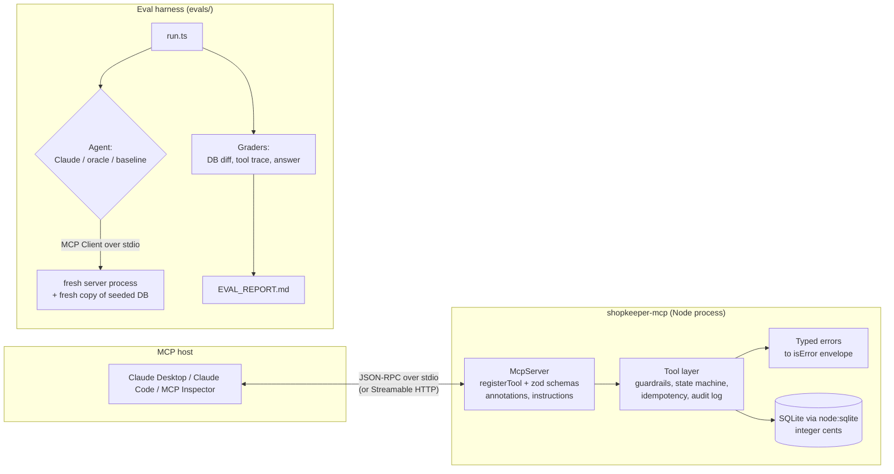

# Shopkeeper MCP

**An MCP server that lets Claude run a small online store's back office (orders, refunds, invoices, sales reports, inventory), with server-side guardrails on every write and an eval harness that checks the agent's behaviour against the real database.**

TypeScript · official MCP SDK (`McpServer.registerTool`) · zod · SQLite (`node:sqlite`, no native build) · vitest · Anthropic SDK (evals only)

| | |
|---|---|
| Tools | 8 (5 read-only, 3 write), with MCP annotations, input/output schemas and typed errors |
| Guardrails | refund caps, required idempotency keys with replay, an order state machine, duplicate-invoice refusal, audit log |
| Tests | 92 vitest tests: unit tests per tool, protocol tests through the MCP `Client`, and a stdio integration test |
| Evals | 15 scenarios; oracle **15/15**, naive agent **6/15**, no-op **0/15**; live Claude: *pending (needs an API key)*, see [EVAL_REPORT.md](EVAL_REPORT.md) |

> All store data is fictional: "Kettle & Crema" is an invented coffee & tea gear shop, customers use `@example.com` addresses.

---

## What it does

Point Claude Desktop, Claude Code or any MCP host at this server and it can answer and act on requests like:

- "Refund order 1042 if it arrived late." It checks the promised and actual delivery dates, then refunds once with an idempotency key.
- "Refund $500 on order 1010." The server refuses, because the order total is $58.95.
- "Mark order 1180 as delivered." Refused: the order is unpaid, and the state machine won't let it skip steps.
- "What were net sales by month in Q2?" / "Which products need reordering?" These are read-only, and no write tool is needed.
- "Cancel Morgan Ellis's pending order." Two customers share that name; the search tool flags the ambiguity so the agent asks which one.

## Tools

| Tool | Kind | What it does | Guardrails / behaviour | Annotations |
|---|---|---|---|---|
| `search_customers` | read | Exact, partial and fuzzy (typo-tolerant, accent-insensitive) search by name or email | Returns `ambiguous: true` and a note when several customers match equally | readOnly, idempotent |
| `get_order` | read | Items, customer, totals, refunds, refundable remainder, invoice, delivery timing (promised vs actual, days late), allowed next statuses | Meant to be called before any write | readOnly, idempotent |
| `list_orders` | read | Filters: status(es), customer, placed date range, min/max total, `late_only`; pagination with `total_count` / `next_offset` | Unknown customer gives `NOT_FOUND`, not an empty list; inverted ranges give `VALIDATION_ERROR` | readOnly, idempotent |
| `sales_report` | read | Gross, refunds and net by day / ISO week / month / product / customer | Excludes pending and cancelled orders; the product view allocates refunds pro-rata to the cent | readOnly, idempotent |
| `low_stock_alerts` | read | Products strictly below their reorder threshold, most urgent first | Suggested quantity refills to target stock, rounded up to the supplier case pack | readOnly, idempotent |
| `update_order_status` | **write** | `pending→paid/cancelled`, `paid→shipped`, `shipped→delivered` | Any other move gives `CONFLICT` with the allowed next statuses; `refunded` is only reachable through refunds; a repeat of the same status is a no-op; audited | destructive, idempotent |
| `issue_refund` | **write** | Refund part or all of a paid order | `amount > 0` and ≤ refundable remainder; refuses unpaid, cancelled and fully refunded orders; `reason` required; **`idempotency_key` required**: the same key replays the original refund, and a different payload gives `CONFLICT`; runs in a `BEGIN IMMEDIATE` transaction; audited; order flips to `refunded` at 100% | destructive, idempotent |
| `create_invoice` | **write** | Invoice for the order total (paid orders are due today; unpaid orders get payment terms) | One invoice per order: a duplicate gives `CONFLICT` with the existing number; cancelled and refunded orders are refused; audited | non-destructive, idempotent |

All tools set `openWorldHint: false`. Inputs are **strict**: an unknown argument such as `dry_run: true` is rejected rather than silently ignored.

**Errors** come back as `isError: true` with a machine-readable envelope:

```json
{"error":{"code":"GUARDRAIL_VIOLATION","reason":"REFUND_EXCEEDS_REFUNDABLE","message":"Requested $500.00 exceeds the refundable amount $58.95 on order 1010 (total $58.95, already refunded $0.00). No refund was issued.","details":{"order_id":1010,"refundable_cents":5895,"requested_cents":50000,"...":"..."}}}
```

`code` is one of `NOT_FOUND`, `VALIDATION_ERROR`, `GUARDRAIL_VIOLATION`, `CONFLICT` (plus `INTERNAL_ERROR`, which never leaks internals). `reason` names the exact rule. Pure schema violations (wrong type, missing field, unknown key) are rejected by the MCP SDK before any handler runs; they also come back as `isError: true`, but with the SDK's `Input validation error: …` text instead of the envelope (the eval harness classifies those as `VALIDATION_ERROR`). Successful calls return a short text summary plus the same JSON in `structuredContent`, validated against each tool's `outputSchema`.

## Architecture



## Quickstart

Requires **Node ≥ 22.13** (built-in `node:sqlite`). Developed on Node 26.

```bash
npm install && npm run seed && npm run build
npm test              # 92 tests
npm run smoke         # spawn the stdio server, list tools, call a read and a guarded write
npm run inspect       # open the MCP Inspector web UI against the server
```

`npm run seed` (re)creates `data/shop.db` deterministically. Re-run it to reset the store between demos. If the database is missing, the server creates and seeds it on first start.

### Configuration

| Setting | CLI flag | Env var | Default |
|---|---|---|---|
| Database file | `--db <path>` | `SHOPKEEPER_DB` | `<repo>/data/shop.db` (resolved from the repo, not the cwd) |
| Store clock | `--now <iso>` | `SHOPKEEPER_NOW` | wall-clock time |

The seed data runs through 2026-09-29, so pin `--now 2026-09-30T18:00:00Z` for reproducible "late / overdue" answers (the snippets below do).

### Claude Desktop

Edit `~/Library/Application Support/Claude/claude_desktop_config.json` (macOS) or `%APPDATA%\Claude\claude_desktop_config.json` (Windows):

```json
{
  "mcpServers": {
    "shopkeeper": {
      "command": "node",
      "args": ["/ABSOLUTE/PATH/TO/shopkeeper-mcp/dist/index.js", "--now", "2026-09-30T18:00:00Z"]
    }
  }
}
```

Restart Claude Desktop. If you use nvm, set `"command"` to the absolute path from `which node`.

### Claude Code

```bash
claude mcp add shopkeeper -- node /ABSOLUTE/PATH/TO/shopkeeper-mcp/dist/index.js --now 2026-09-30T18:00:00Z
```

or commit a project-scoped `.mcp.json`:

```json
{
  "mcpServers": {
    "shopkeeper": {
      "command": "node",
      "args": ["/ABSOLUTE/PATH/TO/shopkeeper-mcp/dist/index.js", "--now", "2026-09-30T18:00:00Z"]
    }
  }
}
```

### Streamable HTTP (optional)

```bash
npm run start:http    # POST http://127.0.0.1:3333/mcp  (PORT to change)
```

Stateless mode, bound to loopback, rejects non-local `Host`/`Origin` headers. It has no authentication, so put an auth layer in front before exposing it anywhere.

## Example

**Real output** from `npm run smoke` (the built server over stdio, MCP SDK client):

```text
tools/list -> 8 tools
  search_customers     read   destructive=false idempotent=true
  get_order            read   destructive=false idempotent=true
  list_orders          read   destructive=false idempotent=true
  sales_report         read   destructive=false idempotent=true
  low_stock_alerts     read   destructive=false idempotent=true
  update_order_status  WRITE  destructive=true idempotent=true
  issue_refund         WRITE  destructive=true idempotent=true
  create_invoice       WRITE  destructive=false idempotent=true

get_order(1042):
Order 1042 - status: delivered; delivered 3 day(s) LATE (promised 2026-03-30, delivered 2026-04-02).
Customer: Marcus Reid <marcus.reid@example.com> (#34).
Total $105.00 (shipping $0.00); refunded $0.00; refundable $105.00.
2 line item(s). Invoice: INV-2026-1042. Refunds on file: 0.

issue_refund(1010, $500.00) -> isError=true
{"error":{"code":"GUARDRAIL_VIOLATION","reason":"REFUND_EXCEEDS_REFUNDABLE","message":"Requested $500.00 exceeds the refundable amount $58.95 on order 1010 (total $58.95, already refunded $0.00). No refund was issued.", ...}}
```

**Illustrative conversation.** This is *not* a recorded Claude run (no live run has been made yet). The tool calls and tool results are what this server returns for these requests; Claude's wording is a sketch.

> **User:** Refund order 1042 if it arrived late.
>
> *→ `get_order({"order_id": 1042})`: "delivered 3 day(s) LATE (promised 2026-03-30, delivered 2026-04-02) … refundable $105.00"*
> *→ `issue_refund({"order_id": 1042, "amount_cents": 10500, "reason": "Late delivery: 3 days after promised date", "idempotency_key": "refund-1042-late-delivery"})`: "Refunded $105.00 on order 1042 (refund #16). The order is now fully refunded."*
>
> **Claude:** Order 1042 was delivered on April 2, three days after the promised March 30 date, so I refunded the full $105.00. The order is now marked refunded.
>
> **User:** Also refund $500 on order 1010.
>
> *→ `get_order({"order_id": 1010})`: "Total $58.95 … refundable $58.95"*
>
> **Claude:** I can't refund $500 on order 1010: the order total is $58.95, which is the most that can be refunded. Do you want a full $58.95 refund instead?

## Screenshots

<!-- TODO(Shubham): capture and add these, then delete this comment.
  docs/screenshots/inspector-tools.png      - Inspector tool list showing read vs write annotations
  docs/screenshots/inspector-guardrail.png  - issue_refund $500 on order 1010 returning GUARDRAIL_VIOLATION
  docs/screenshots/claude-desktop-refund.png - Claude Desktop handling "Refund order 1042 if it arrived late"
  docs/screenshots/eval-report.png          - EVAL_REPORT.md scenario matrix
-->

*Screenshots coming soon: Inspector tool list, a guardrail refusal, Claude Desktop handling a refund, and the eval matrix.*

## Evals

Agents that call write tools need more than unit tests. The harness in [`evals/`](evals/) runs **15 natural-language scenarios** end to end against the real server and grades each one deterministically, with no LLM judge.

- **Isolation:** every attempt gets a fresh copy of the seeded DB and its own `node dist/index.js` process, driven over stdio by the MCP SDK `Client`. The clock is pinned.
- **Graders** check three independent things:
  1. **Final DB state**, diffed table by table against the untouched template. Examples: exactly one new refund for 1042 equal to the order total; no new refund rows on a retried idempotent refund; every table unchanged on read-only questions.
  2. **Tool-call trace**: required tools, forbidden tools (any write tool on a read-only question, a second refund attempt on a refunded order, marking an unpaid order `paid` to force `delivered`), ordering (`get_order` before `issue_refund`), and idempotency-key reuse.
  3. **Final answer**, with light, tolerant checks: mentions the right amount (±$1), the invoice number, every late order ID.

  Expected values are computed with SQL on the database, never copied from tool output, so a buggy tool can't grade itself.
- **Three modes:**

| Command | Agent | Needs key |
|---|---|---|
| `npm run eval` | Claude via the Anthropic SDK: MCP tools converted to Anthropic tool definitions, manual tool-use loop (max 12 turns), default `claude-sonnet-5-5` at effort `medium`, server-side refusal fallback, token usage and cost tracked | yes |
| `npm run eval:oracle` | Scripted known-good tool sequence per scenario, run through the real server and graded by the same graders | no |
| `npm run eval:baseline` | No-op agent and a naive keyword agent | no |

**Current results** (from [EVAL_REPORT.md](EVAL_REPORT.md)):

| Agent | Scenarios passed |
|---|---|
| Claude (live) | *pending: run `npm run eval` with `ANTHROPIC_API_KEY` set* |
| Oracle (scripted known-good) | **15/15** |
| Naive keyword agent | **6/15** |
| No-op agent | **0/15** |

The oracle at 15/15 shows the server and graders agree. The baselines show the graders discriminate. The naive agent passes only literal one-step requests and cases where the *server's* guardrails stopped it. It fails everything that needs judgement: it refunds an on-time order, double-refunds a retried refund, and turns a read-only question into a write.

**Running the live eval**

```bash
cp .env.example .env                 # set ANTHROPIC_API_KEY=...
npm run eval                         # all 15 scenarios, claude-sonnet-5-5
npm run eval -- --model claude-haiku-5-5 --trials 3      # cheaper model, 3 trials each (pass^3)
npm run eval -- --only idempotent-retry,ambiguous-customer --effort low
```

Without a key, `npm run eval` exits immediately with instructions. Every run writes `evals/results/<agent>.json` (full trace, final answer, usage, cost) and regenerates `EVAL_REPORT.md`.

## Design decisions

- **Guardrails live in the server, not the prompt.** Refund caps, the state machine and duplicate checks are enforced in a transaction no matter which client calls. The baseline results show the effect: even a careless agent cannot over-refund or skip from `pending` to `delivered`.
- **Idempotent writes.** `issue_refund` requires an `idempotency_key` (unique in the DB). Replaying the same key returns the original refund with `replayed: true` and changes nothing; reusing a key for a different amount or order is a `CONFLICT`. Agents can retry after timeouts without paying twice. That is exactly what the `idempotent-retry` scenario tests.
- **Money is integer cents end to end.** `CHECK` constraints keep `total = subtotal + shipping` and `refund > 0`. Formatting to dollars happens only in summaries, and pro-rata refund allocation uses largest-remainder so no cent is lost or invented.
- **Honest annotations.** Reads are `readOnlyHint: true`; writes declare `destructiveHint`/`idempotentHint`, so hosts can gate confirmations. `openWorldHint: false` everywhere: the server touches only its own database.
- **Strict schemas, structured output.** zod input schemas reject unknown keys; every tool has an `outputSchema` and returns `structuredContent`. Error results deliberately omit `structuredContent`, because MCP clients validate it against the output schema.
- **State machine over free-form status edits.** Cancel is only allowed before payment; paid orders are unwound through refunds, and `refunded` is set automatically when refunds reach the total, so money and status can't disagree.
- **Everything audited.** Each successful write appends to `audit_log` with actor, action and details; replays and refusals write nothing.
- **Deterministic by construction.** A fixed-seed PRNG plus pinned fixtures (late order 1042, refunded order 1077, two customers named "Morgan Ellis", stock below threshold, …) and an injectable clock. Tests and evals are reproducible to the byte.
- **Small runtime footprint.** Runtime dependencies are only `@modelcontextprotocol/sdk` and `zod`. The Anthropic SDK and dotenv are dev-only, used by the eval harness. stdout carries JSON-RPC only; all logs go to stderr.

## Project layout

```text
src/
  index.ts            stdio entrypoint (auto-seeds a missing DB)
  http.ts             optional Streamable HTTP entrypoint (stateless, loopback)
  server.ts           McpServer + tool registration + error mapping
  tools/              one file per tool (zod schemas, handler, annotations)
  domain/             state machine, delivery/refund rules, fuzzy matching
  db/                 schema, connection/transactions, deterministic seed
  errors.ts money.ts clock.ts config.ts
tests/                vitest: per-tool, protocol (in-memory Client), stdio integration, seed, graders
evals/
  scenarios.ts        15 scenarios: prompt, oracle, graders
  graders.ts          assertion library (DB diff, trace, answer)
  harness.ts          spawns the real server per attempt, traces tool calls
  agents/             claude.ts (live), scripted.ts (oracle, naive, no-op)
  run.ts report.ts    CLI + EVAL_REPORT.md generator
  results/            latest results per agent (JSON)
scripts/smoke.ts      end-to-end smoke test
```

## Scripts

| Script | What it does |
|---|---|
| `npm run build` / `npm start` | Compile (tsc strict) / run the stdio server |
| `npm run seed` | Recreate `data/shop.db` deterministically |
| `npm test` / `npm run check` | Tests / typecheck everything + tests |
| `npm run smoke` | Spawn the built server and exercise it with the MCP SDK client |
| `npm run inspect` / `npm run inspect:cli` | MCP Inspector web UI / list tools from the terminal |
| `npm run eval` / `eval:oracle` / `eval:baseline` / `eval:report` | Evals (see above) |

## License

[MIT](LICENSE) © 2026 Shubham Garje. Demo data is fictional; any resemblance to real people or businesses is coincidental.
